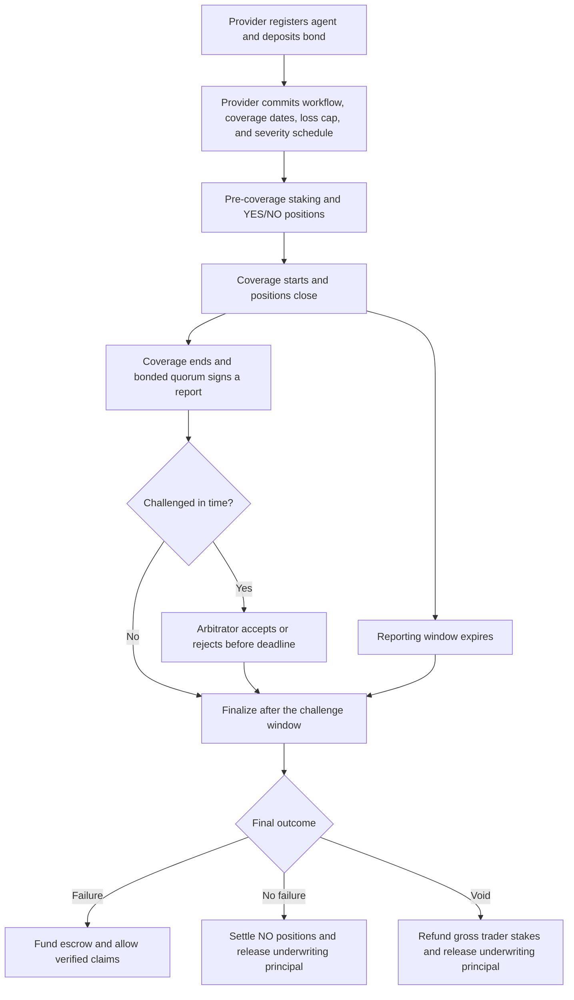

# Acntbl

Acntbl is a Foundry prototype for AI agent accountability. It combines a provider bond and an underwriting pool with a binary prediction market. After an oracle finalizes a covered incident, verified victims can claim a share of the compensation pool. Traders earn from correct predictions. Underwriters receive explicitly funded premiums and accept the risk of losing principal.

## Run the simulation

Install Foundry v1.3.1 or later, then run:

```bash
./script/bootstrap.sh
forge test -vv
forge test --match-test testDisputedFailureSlashesAndCompensatesVictimsProRata -vvvv
```

The bootstrap script installs forge-std v1.9.7 and OpenZeppelin Contracts v5.2.0. Foundry uses Solidity 0.8.28. The simulation deploys a mintable test token and wires all five contracts in `test/Accountability.t.sol`. No RPC or funded wallet is required.

## Contracts

| Contract | Responsibility |
| --- | --- |
| `AgentRegistry` | Registers an agent with a provider, metadata URI, risk tier, and ERC-20 bond. Locks the bond during an active epoch. Tracks verified incidents and reduces the agent operator's credibility in proportion to the recognized loss relative to the epoch cap. |
| `UnderwritingVault` | Locks staker principal in an agent's epoch pool, accepts externally funded premiums, and redeems each staker's share of remaining principal plus premiums. Only the settlement coordinator can slash, and only for a finalized failure. |
| `FailurePredictionMarket` | Runs a binary parimutuel market. A fee on each position funds an epoch reserve. Winning positions share the net pot in proportion to net stakes on the winning side. |
| `CompensationEscrow` | Pays victims named in the oracle's Merkle root. Tracks distinct claim IDs and caps cumulative eligible loss at the signed aggregate. Anyone may relay a valid proof. |
| `MockOracle` | Coordinates settlement, verifies bonded EIP-712 attesters, manages a bonded challenge window and arbitration, and accepts proofs of attester double signing. |

## Epoch and dispute flow



- **Before coverage.** The provider sets the epoch terms in `openEpoch`. One epoch can be active per registered agent. The workflow hash commits to the exact policy for evaluating failure and allocating losses. Market activity and underwriting deposits close at `opensAt`. The protocol treats risk tier as registration metadata and uses the disclosed epoch terms for the actual financial limits.
- **Reporting.** The coverage interval is `[opensAt, endsAt)`. After it ends, anyone can relay a bonded quorum's signed report, with a proposer bond, before the reporting deadline. The report must commit to evidence. An exact financial loss uses collateral base units. A deterministic incident without a numerical loss uses one of the three precommitted severity amounts. A zero-loss report uses both modes' zero values and an empty claim root. A failure report commits to the eligible victims and their aggregate loss. The signed aggregate must equal the reported exact loss or scheduled severity amount. The cap limits funding while preserving the full claims denominator.
- **Challenge.** Anyone other than the proposer can post the same bond and commit counter-evidence before the challenge deadline. Once the challenge window closes, the mock arbitrator can uphold the signed report or void the epoch during the arbitration window. The winning side receives both bonds. An arbitration timeout voids the epoch and credits both parties their own bonds. A missing report also voids the epoch. Credits can be withdrawn independently of settlement.
- **Double signing.** Any caller can submit two different valid report digests signed by the same enrolled attester for the same epoch. Reports are final attester statements, so changing the evidence, claims, or outcome on a second signed report is equivocation. Proof forfeits that attester's bond, drops their credibility to zero, and excludes that signature from the epoch quorum. If a pending report falls below quorum, it voids on settlement. A late proof still penalizes the signer. Settled payouts are final.
- **Market.** At any time, the contract can display net YES stake divided by total net stake. This is a stake-weighted market signal, and the payout odds can move as positions are added. The winner claims a share of the net pot. If no one backed the winning outcome, the market refunds net stakes. A void refunds full positions including fees. On a valid outcome, fees left after victim funding go to the configured reserve recipient. Underwriter premiums are funded explicitly with `fundPremium`.
- **Compensation.** The recognized loss equals the lesser of the reported loss and the epoch cap. The escrow draws the market fee reserve first, then the provider bond, then the vault's principal, up to that recognized loss. The prediction pot and underwriting premiums remain available to their respective recipients. Each victim receives their approved loss multiplied by escrow funding and divided by total verified claims, rounded down. Claims are pull-based and have no expiry in this prototype. Integer rounding can leave dust.

## Example

A verified workflow failure causes 600 units of loss. Two verified victims lost 400 and 200 units. The market reserve contributes 20, the provider bond contributes 100, and the vault can contribute 300. Escrow pays 280 and 140 units, respectively, which is 70% of each verified loss. In the same test, YES traders settle against the 380-unit net trading pot.

## Connecting the monitoring oracle

The monitor should publish a workflow manifest and retain deterministic evidence for each incident: workflow and policy versions, affected execution IDs and time bounds, state or event references, the reproducible loss calculation, and deduplicated claim IDs. For example, a settlement agent sending funds against a committed beneficiary list can be evaluated against that list and the final transaction events. A hallucination qualifies when its output violates a precommitted, reproducible check and triggers a covered consequence. The severity schedule handles consequences that can be classified deterministically but have no direct monetary measure.

Attesters independently replay the workflow and rebuild the Merkle root before signing. The root uses OpenZeppelin sorted pairs and a double-hashed leaf described by `CompensationEscrow.claimLeaf`:

```text
keccak256(bytes.concat(keccak256(abi.encode(chainId, escrow, epochId, claimId, victim, loss))))
```

Use canonical IDs and one consistent manifest for the whole epoch. Evidence and the claim leaf set must be available for meaningful challenges and proof generation. `MockOracle.reportDigest` returns the EIP-712 digest for the `Report` defined in `IIncidentOracle`. Its domain uses the name `AI Accountability Oracle`, version `1`, the current chain ID, and the oracle contract address. Keep raw victim records and unrelated identifiers out of the public evidence.

## Deployment and integration boundaries

Deploy the mock oracle first with the ERC-20, arbitrator, recipient, windows, bonds, and committee. Deploy the registry, vault, market, and escrow with the oracle as coordinator and the same ERC-20. The oracle deployer calls `bind` once. Attesters fund their bonds, then providers can register and open epochs. Use a standard, non-rebasing ERC-20 without transfer fees. Simulations use mock collateral.

The vault models local ERC-20 underwriting and exposes `IUnderwritingVault` as the restaking seam. EigenLayer and Symbiotic adapters are future integrations. A live adapter must map epochs to slashable operator allocations, align withdrawal and dispute timing with the upstream allocation snapshot, and credit escrow only after redistribution delivers collateral. If the upstream slash is asynchronous, split settlement into a slash request and a later funding finalization. See [EigenLayer contracts](https://github.com/Layr-Labs/eigenlayer-contracts) and [Symbiotic slashing](https://docs.symbiotic.fi/learn/core-concepts/slashing).

The oracle models an optimistic assertion with a bonded challenge and an explicit arbitrator. An [UMA OOv3 adapter](https://docs.uma.xyz/developers/optimistic-oracle-v3) and the continuous monitoring service are outside this on-chain prototype. The fixed mock committee has no rotation or bond exit. A sufficiently colluding attester quorum or arbitrator can influence outcomes, and the contracts cannot independently check evidence availability or whether a claim root omits a valid victim. Agent credibility is per registration, so a new registration starts a fresh score. The prototype is intended for local testing and testnet evaluation.
